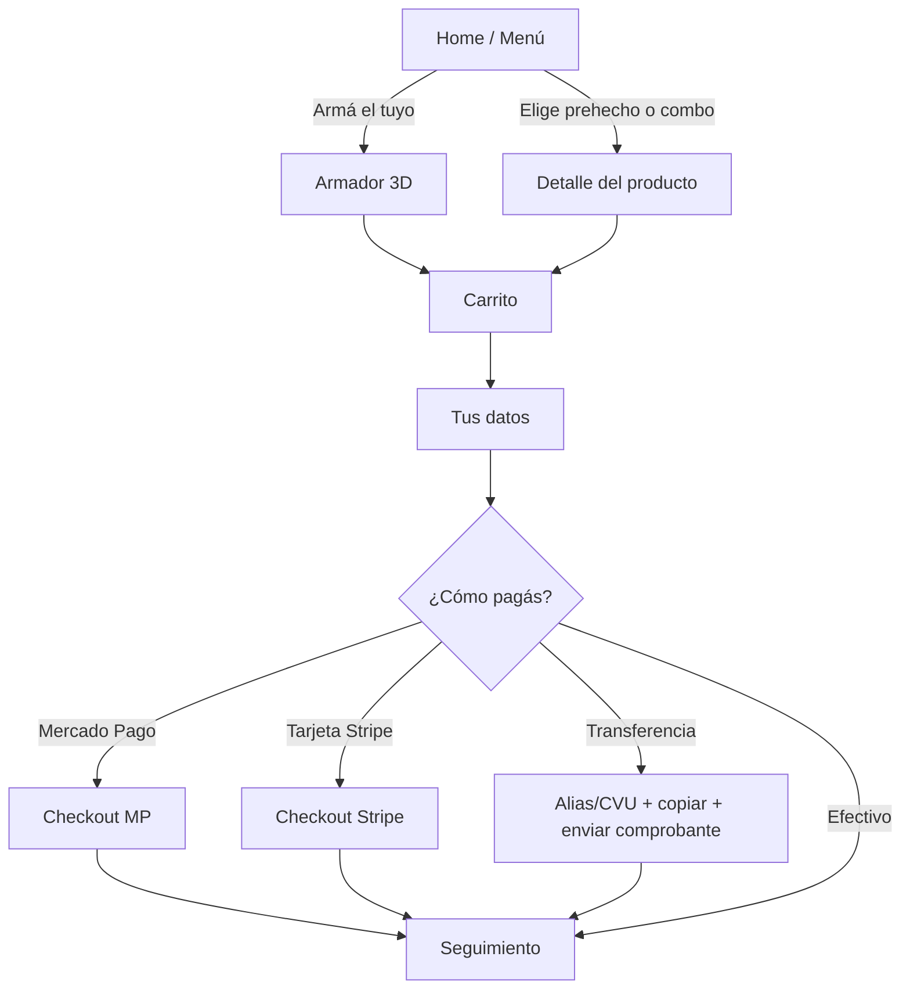

# Flujo del cliente

## Pantallas

### 1. Home (actualizado 2026-10-29)
- Arriba: logo, estado "Abierto ahora / Cerrado", botón carrito.
- **Hero (pantalla completa junto al encabezado):** título **"Burrito a tu Gusto"**, el burrito con papas chico ("desde $X"), botón **"Armá tu burrito"** y dos botones de redes (Instagram y WhatsApp), todos compactos. Debajo, **a todo el ancho y sin tarjeta**, asoma el armador: una fila y media de ingredientes nítida (se eligen solas) que se **desenfoca hacia abajo**, con el botón "Armá tu burrito" y "o elegí uno de la casa ↓" encima del desenfoque. El armador es **opcional**: se abre ahí mismo y se cierra con "Ver combos". Textos de marca en `apps/web/src/lib/marca.ts`.
- **Tu burrito:** si la persona ya terminó de armar uno (aunque no lo haya guardado ni pedido), aparece **primero en la grilla de combos** con la etiqueta verde "Tu burrito", borde verde que se degrada en la tarjeta, "Agregar" y "Editarlo". Solo se muestra si ya armó uno. Los combos guardados quedan a un toque con "Ver tus combos guardados (N)".
- **Combos de la casa:** grilla de **2 columnas** con burritos prehechos con papas (salen de `productos` + su receta; hoy 4 de ejemplo: Clásico, Pollo y choclo, El Doble, Del Mar). Todos muestran la foto del burrito con papas. "Agregar" y "Cambiarle algo" (lo abre en el armador para modificarlo).
- Debajo de "Siguiente" en el armador: "Borrar y empezar de nuevo" en gris, con "Deshacer".

### 2. Armador (ver [[04 Armador 3D]])
- Un paso por pantalla, barra de progreso arriba ("Paso 3 de 7").
- Mitad superior: el burrito 3D. Mitad inferior: opciones en tarjetas.
- Contador visible: **"Rellenos 3/4"**. Al llegar al límite, las demás tarjetas se apagan con mensaje "Llegaste al máximo".
- Botón fijo abajo: "Siguiente" + precio parcial.

### 3. Carrito
- Lista de ítems con detalle de ingredientes plegable, cantidad +/-, editar (vuelve al armador con todo cargado), eliminar.
- Subtotal, envío (cuando ya eligió zona), total.

### 4. Tus datos
- Nombre, teléfono, ¿Delivery o retiro?, dirección + referencias, email (opcional, con texto "solo si querés el comprobante").
- Se recuerdan en el dispositivo para el próximo pedido.

### 5. Pago
- 4 botones grandes con ícono. Efectivo pregunta "¿Con cuánto pagás?".
- Transferencia muestra alias/CVU con botón **Copiar** y botón **Enviar comprobante por WhatsApp**.

### 6. Seguimiento
- URL privada `/pedido/[id]?t=[token]`.
- Número de pedido grande, estado en línea de tiempo, se actualiza solo.
- Botón WhatsApp al local.

## Principios
- Nada de texto chico. Íconos + palabras siempre.
- Todo reversible: volver atrás nunca pierde lo elegido.
- Errores en lenguaje humano: "Falta tu teléfono" en vez de "Campo requerido".
