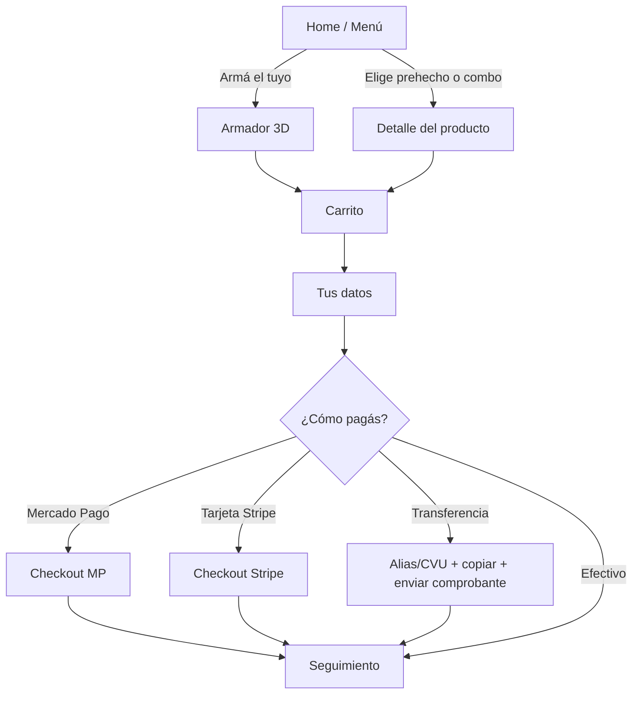

# Flujo del cliente

## Pantallas

### 1. Home
- Arriba: logo, estado "Abierto ahora / Cerrado", botón carrito.
- Héroe con burrito 3D girando + botón gigante **"Armá tu burrito"**.
- Tabs por menú: Burritos · Combos · Bebidas · Acompañamientos.
- Tarjetas grandes con foto/render, nombre, precio, botón "Agregar".

### 2. Armador (ver [[04 Armador 3D]])
- Un paso por pantalla, barra de progreso arriba ("Paso 3 de 7").
- Mitad superior: el burrito 3D. Mitad inferior: opciones en tarjetas.
- Contador visible: **"Rellenos 3/4"**. Al llegar al límite, las demás tarjetas se apagan con mensaje "Llegaste al máximo".
- Botón fijo abajo: "Siguiente" + precio parcial.

### 3. Carrito
- Lista de ítems con detalle de ingredientes plegable, cantidad +/-, editar (vuelve al armador con todo cargado), eliminar.
- Subtotal, envío (cuando ya eligió zona), total.

### 4. Tus datos
- Nombre, teléfono, ¿Delivery o retiro?, dirección + referencias, email (opcional, con texto "solo si querés el comprobante").
- Se recuerdan en el dispositivo para el próximo pedido.

### 5. Pago
- 4 botones grandes con ícono. Efectivo pregunta "¿Con cuánto pagás?".
- Transferencia muestra alias/CVU con botón **Copiar** y botón **Enviar comprobante por WhatsApp**.

### 6. Seguimiento
- URL privada `/pedido/[id]?t=[token]`.
- Número de pedido grande, estado en línea de tiempo, se actualiza solo.
- Botón WhatsApp al local.

## Principios
- Nada de texto chico. Íconos + palabras siempre.
- Todo reversible: volver atrás nunca pierde lo elegido.
- Errores en lenguaje humano: "Falta tu teléfono" en vez de "Campo requerido".
